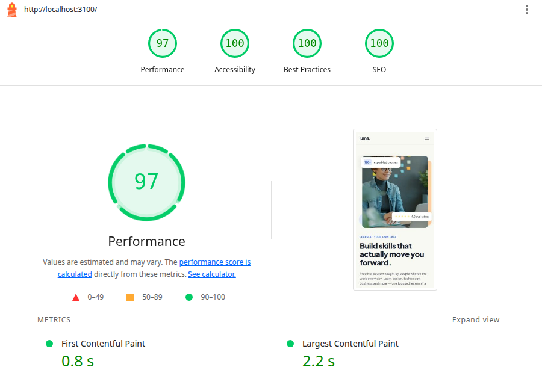
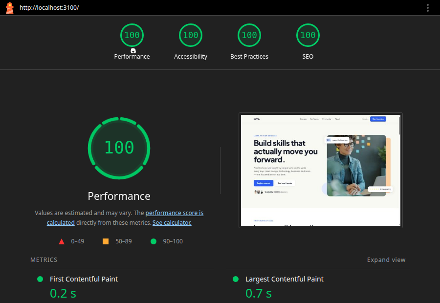

# luma. – Buzzvel Front-End Coding Challenge (Nov 2026)

This project was built as part of my application for a front-end position at Buzzvel. The challenge was to reproduce a Figma design (a landing page for "luma.", a learning platform, with desktop and mobile layouts) as a responsive Next.js front end.

Live preview: <https://luma-dusky.vercel.app/> · Figma: <https://www.figma.com/design/G0zSf6gyynwzEusOCgm2CM/Buzzvel-FE---Test-2026>

## How I approached it

1. I gave the challenge PDF to Claude and asked for an implementation plan based on the Figma design ([`PLAN.md`](PLAN.md), written in Portuguese), then reviewed it.
2. The Figma connector (MCP) could not be used with this file (view-only access), so I extracted everything by hand: the desktop and mobile frames, each section as an image, icons and photos. For typography, colors, spacing and the rest, I copied the CSS of the desktop and mobile frames and asked the AI to turn it into a single reference document, [`design-refs/notes.md`](design-refs/notes.md), which guided the whole implementation.
3. I built it phase by phase (tokens and base layout, static sections, interactions, quality pass, docs) and reviewed each phase before moving on.

One lesson along the way: the AI kept adjusting spacing by measuring the PNG exports (which ignore line-height boxes), even though the exact values were already in the CSS extraction. I made `notes.md` the single source of truth. Differences of up to ~3 px between Figma and the browser are normal text rendering, so I compared visually and only fixed what was noticeable, instead of adding magic numbers.

## Stack

Next.js 16 (App Router) · React 19 · TypeScript (strict) · Tailwind CSS v4 · `next/font` · `next/image`.
`clsx` is the only extra dependency.

## Getting started

```bash
npm install
npm run dev                      # http://localhost:3000
npm run build && npm run start   # production build
npm run lint
npx tsc --noEmit                 # type-check
```

Optional: set `NEXT_PUBLIC_SITE_URL` on hosts other than Vercel so `og:image` gets an absolute URL
(fallback order: `NEXT_PUBLIC_SITE_URL`, the Vercel production domain, `http://localhost:3000`).

## Project structure

```
src/
  app/                layout, page, global styles and design tokens, generated OG image and favicon
  components/
    layout/           Header, MobileMenu, Footer
    sections/         one component per Figma section (+ ContactForm)
    ui/               primitives: Container, Button, AppLink, SectionHeading, Field, ResponsivePicture
  data/content.ts     all copy, lists and links (mock data)
  types/content.ts    types for that content
  fonts/              font file used by the OG image
public/               SVG icons and images
design-refs/          Figma exports (desktop/mobile) and notes.md (tokens, interactions, decisions)
docs/                 Lighthouse scores and screenshots
PLAN.md               the phase plan this project followed
```

## Key decisions

- **Breakpoints and tablet.** Mobile < 768px, tablet 768–1023px, desktop ≥ 1024px (`lg`). The tablet layout is not in Figma, so it is my own: mobile header with the hamburger, mobile type scale, hero and featured course stacked with the photo capped and centered, categories in a 2×2 grid, "how it works" in 3 columns without the connector, footer in one row.
- **Container.** The Figma frame is 1280px wide with 1120px of content. Two sections measure 1136px in Figma (featured course and testimonial); I normalized everything to 1120px.
- **Hero between 1024 and 1279px.** The title needs room next to the photo, so the whole visual (photo, badges, peach bar, circle) is scaled to 80% with CSS `zoom`. Shrinking only the photo made the "120+" badge cover the eyes. The mobile layout uses a separate crop of the photo (`<picture>` with `getImageProps`).
- **Images per breakpoint.** Two images (hero and featured course) are different crops on mobile and desktop. A small `ResponsivePicture` component swaps them with `<picture>`, so the browser downloads only the one it needs.
- **Avatars.** The hero avatars (cream border) and final CTA avatars (yellow border) were exported with the border baked in, so no border is added with CSS.
- **OG image and favicon.** The design has neither, so both are generated in code (`opengraph-image.tsx`, `icon.tsx`) with the brand colors and font.
- **Anchors.** A link points to a section only when its name matches one (Courses and "Explore…" go to Categories, Contact to Contact, and so on). Everything else uses `#`, because those pages do not exist.
- **No UI or interaction libraries.** The mobile menu (Esc, click outside, link click, resize, focus trap, scroll lock) and the form are plain React.
- **Typed content.** All copy, lists and links live in `src/data/content.ts` with types in `src/types/content.ts`. Components receive them as props.
- **`AppLink`.** With `next/link`, clicking an anchor whose hash is already in the URL does nothing once the user has scrolled away. In-page anchors use a plain `<a>`; routes still use `<Link>`.
- **Mobile menu panel.** It is not designed in Figma. I built it from the existing styles (cream background, body links, primary button).
- **Contact form.** Client-side validation on blur and on submit (`noValidate`, own messages, `aria-invalid`, `aria-describedby`, focus on the first error), then a mock send ("Sending…" for 800 ms and a success message). Nothing is sent anywhere.
- **Colors that are not in Figma.** Error red `#B42318` and button hover `#2A4BDC`. Contrast fixes (AA): `text-muted` is `#6A7081` instead of `#6D7384`, and the featured course chips and "Browse all courses" are white instead of `#E7E7EC`.
- **WebP.** The large photos are stored as WebP (quality 95): 4.8 MB to 0.8 MB, visually lossless. `next/image` serves them resized.
- **`inlineCss`.** `experimental.inlineCss` puts the small Tailwind CSS in the HTML and removes the render-blocking stylesheet request.

## Design inconsistencies found

- "STEP 01" is repeated on all three steps on desktop. Mobile numbers them 01/02/03, so I used that.
- Step 2 text differs between mobile ("actually use") and desktop. I used the desktop copy.
- The mobile contact form has Portuguese copy ("E-mail", "seuemail@exemplo.com"). I used the English desktop copy.
- A few colors differ per breakpoint (step 2 icon background, People paragraph, copyright). I followed each breakpoint as designed.
- The People section copy is lorem ipsum in the design. Kept as is.
- The People section background is cream in the full-frame exports (the section export is transparent). I used cream.

## Known gaps

- Links to pages that do not exist (For Teams, Community, About, Log in, Careers, Journal, Help Center, Terms, Privacy, Instructors, View course, category cards) point to `#`.
- The mobile People collage is about 34 px taller than Figma. It is an accepted consequence of exporting the collage as 4 column images that keep their aspect ratio.
- The mobile Lighthouse performance score varies between runs (91–99): the simulated LCP sometimes jumps from ~2.2 s to ~3 s, while the LCP measured locally is ~200 ms.
- Not tested with a real screen reader. Keyboard behavior and ARIA attributes were checked in Chrome.
- `experimental.inlineCss` is experimental and may change in future Next.js versions.
- Hover states are not in the design. They are my own, kept subtle.

## Accessibility & performance

Lighthouse on the production build (median of 3 runs):

| | Performance | Accessibility | Best Practices | SEO |
|---|---|---|---|---|
| Mobile | 97 | 100 | 100 | 100 |
| Desktop | 100 | 100 | 100 | 100 |

Details in [`docs/lighthouse.md`](docs/lighthouse.md).




- **Accessibility:** skip link, landmarks, a single `<h1>` with ordered headings, semantic lists, `figure`/`blockquote`, `dl` for the stats, real labels, visible `:focus-visible` ring on every background, full keyboard support, `prefers-reduced-motion` (no smooth scroll, no transitions), AA contrast, descriptive `alt` (decorative images use `alt=""`).
- **Performance:** Server Components by default (client JavaScript only for the mobile menu and the form), `next/font` with only the weights used, `next/image` with accurate `sizes`, the hero photo is the only eager image (`fetchPriority="high"` plus a media-scoped preload), separate mobile crops, WebP sources, inlined CSS.

## Time spent

~5 hours (planning and Figma extraction included)

## AI tools used

- **Claude (claude.ai):** planning, turning the Figma CSS export into structured design notes (`design-refs/notes.md`), and reviewing the output of each phase before I approved it.
- **Claude Code (VS Code):** implementation, plus the throwaway scripts used for testing (Lighthouse and keyboard tests, kept outside the project dependencies).

How I checked the result: visual comparison against the Figma exports at 402, 820 and 1280px; scripted keyboard tests in a real Chrome (menu, form, anchors, Tab order); Lighthouse on the production build; lint, type-check and build on every step; a pass on a real phone through the Vercel preview. I reviewed every change and can explain the code.
